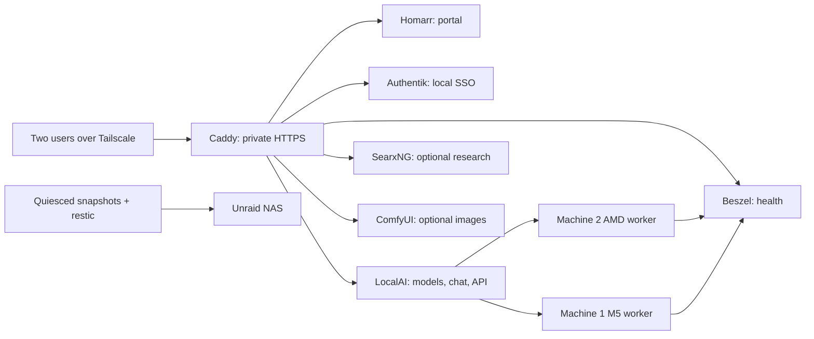

# Nexus infrastructure

All persistent services run on **machine 2**. Machine 1 runs a LocalAI worker and monitoring agent. Keep the NAS separate from inference and application databases.

| Package | Responsibility |
| --- | --- |
| [localai](localai/README.md) | Authenticated model controller, PostgreSQL/NATS, AMD workers, model placement |
| [platform](platform/README.md) | Private HTTPS, SSO, portal, monitoring, research, memory, encrypted backups |
| [workloads](workloads/README.md) | Optional image generation and isolated training jobs on machine 2 |
| [hosts](hosts/README.md) | Pinned Ubuntu machine-2 Docker/Tailscale bootstrap |

Deployment order: provision Linux/Docker/Tailscale → LocalAI loopback administrator → platform loopback accounts → export/trust CA and configure DNS → publish to Tailscale → connect LocalAI OIDC → enroll agents → establish/test NAS backup → enable optional workloads.

`lab.home.arpa` is the agreed private placeholder. Configuration generation accepts a different domain before initial deployment. No DNS records, host packages, firewall rules, Tailscale policies, timers, or trust stores are modified by initialization.

The host kernel and AMD driver remain host responsibilities. Containers pin user-space runtimes; they cannot replace an unsupported host kernel/driver. Start with a supported Ubuntu release on machine 2; validate the M5 separately before choosing its final distribution.

Subscription-backed Codex/Claude CLI workflows remain separate from the general inference endpoint. Optional paid OpenRouter routing should be configured explicitly with a budget and tested using a distinct cloud alias; never silently fall back from a local alias to a paid service.
