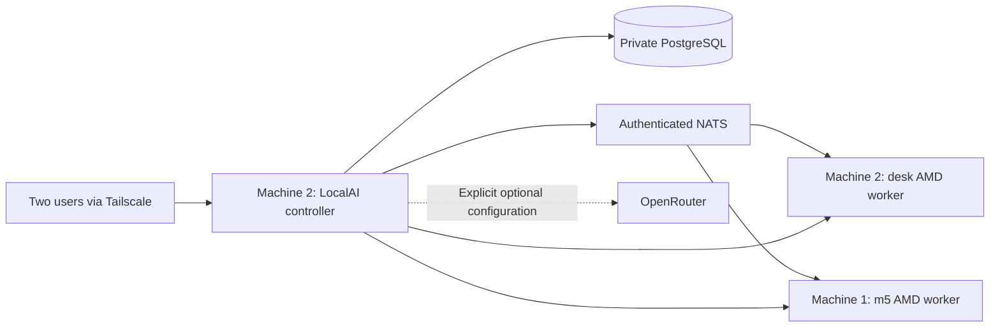

# LocalAI controller pilot

This directory contains the controller design, runnable lifecycle scripts, Compose files, image pins, and verification tests for the two-machine homelab. Machine 2 runs the controller, PostgreSQL and NATS. Each AI host runs a separate worker project. The controller has no GPU devices attached.

Status: prepared against LocalAI **v4.11.0** source and verified registry manifests on **2026-10-12**. Configuration/lifecycle tests run locally. GPU inference, live container startup, OIDC login, and an actual database restore still need host validation. This is a pilot, not a completed host installer.

## Layout and architecture



- `lab.py`: initialize, validate, start, bootstrap administrator, publish, export workers, backup and restore.
- `controller.compose.yaml`: CPU controller and private state/coordination services.
- `worker.compose.yaml`: AMD Vulkan worker with its own models and backend cache.
- `images.env`: registry digest pins. No floating `latest` image is used.
- `config/scheduling.yaml`: declarative model-to-worker placement.
- `config/artifacts.example.json`: model/backend provenance template, never consumed as a real model config.
- `RESEARCH.md`: source findings, design decisions, gaps, and acceptance checks.
- `OPERATIONS.md`: SSO, recovery, upgrades, storage, and benchmarking.
- `tests/`: offline lifecycle checks and actual Compose rendering tests.

## Prerequisites

On the controller: Linux, Python 3.11+, Docker Engine, Docker Compose v2+ with `--wait`, and enough local NVMe space. On each GPU worker: those prerequisites plus working AMD kernel/firmware, `/dev/dri`, `/dev/kfd`, and host `video`/`render` groups. Docker access is required to start containers. Installing the OS, Docker, GPU drivers, Tailscale, and firewall rules is a separate host-provisioning phase.

Run from this directory. Commands below are the maintained entrypoints, rather than one-off replacement deployment commands. Configuration and secrets are generated under ignored `.runtime/`; no secrets are printed during setup or validation. Protect Docker access because it allows inspection of container credentials.

## Machine 2: bootstrap controller

```bash
python3 lab.py init-controller --admin-email YOUR_EMAIL
python3 lab.py validate
python3 lab.py up
python3 lab.py bootstrap-admin
```

The API initially binds only `127.0.0.1:18080`. Run bootstrap on Machine 2, or use an SSH tunnel to its loopback UI. The password is read from a terminal and is not saved by this script. First-user administrator assignment is why this step happens before publishing. Invite-only registration gates subsequent users; it does not gate the first user.

After bootstrap, confirm Tailscale is running and set Machine 2's real Tailscale IPv4 address:

```bash
python3 lab.py publish --ip MACHINE_2_TAILSCALE_IPV4
python3 lab.py up
```

The UI is now at `http://MACHINE_2_TAILSCALE_IPV4:18080`. This initial HTTP path travels inside Tailscale's encrypted tunnel. Restrict tailnet access to your two users and the worker nodes. PostgreSQL and NATS monitoring have no published host ports. NATS client port 14222 is published on the controller's explicit Tailscale address. Do not publish these services through your router.

## Add desk and m5 workers

On Machine 2, export a worker-only credential bundle for each node:

```bash
python3 lab.py export-worker --name desk --worker-ip MACHINE_2_TAILSCALE_IPV4 --output .runtime/desk-worker.env
python3 lab.py export-worker --name m5 --worker-ip MACHINE_1_TAILSCALE_IPV4 --output .runtime/m5-worker.env
```

Transfer `m5-worker.env` privately to Machine 1. It includes the enrollment token and shared NATS password, but not the PostgreSQL password or API-key HMAC secret. Each worker uses its own state directory, including the desk worker on Machine 2:

```bash
# On Machine 2:
python3 lab.py --state-dir .runtime/desk init-worker --credentials .runtime/desk-worker.env
python3 lab.py --state-dir .runtime/desk validate
python3 lab.py --state-dir .runtime/desk up

# On Machine 1, using the transferred credential file:
python3 lab.py --state-dir .runtime/m5 init-worker --credentials /PRIVATE/PATH/m5-worker.env
python3 lab.py --state-dir .runtime/m5 validate
python3 lab.py --state-dir .runtime/m5 up
```

Approve each worker in LocalAI's Nodes UI. Workers bind only their explicit Tailscale IP for HTTP staging/health on 50050 and dynamic gRPC on 50051–50100. Tailnet policy should allow the controller to reach these worker ports and workers to reach controller 18080/14222. Browser users only need the UI/API path; restrict administration in LocalAI itself.

The worker container remains on a Docker bridge and reports the published host address, not its internal container address. Initial VRAM budget is 80% of reported capacity; measure available M5 shared memory and adjust after testing. This does not configure host UMA memory or reserve GPU time for training.

## Models and two users

No model weights are downloaded automatically. Install one modest coding model on desk first, then a larger model on m5. Explicitly select `vulkan-llama-cpp` for the initial inference comparison; retain ROCm as a separately tested variant. Use the exact installed model names in `config/scheduling.yaml`.

```bash
python3 lab.py sync-config
python3 lab.py restart
```

Issue an invite for the occasional user and give that user ordinary permissions. Create separate per-user/client API keys in the UI. Test streaming and tool calls from the real coding clients before adding long contexts or speculative decoding. No cloud keys, subscription adapters, agent execution workers, or Docker socket mounts are included.

## Verification and lifecycle

```bash
python3 -m unittest discover -s tests -v
python3 lab.py status
python3 lab.py logs
python3 lab.py backup --destination /PRIVATE/BACKUP/STAGING
python3 lab.py verify-backup --backup /PRIVATE/BACKUP/STAGING/TIMESTAMP
python3 lab.py down
```

`down` preserves named volumes and all local state. `restart` recreates the selected controller or worker from its saved configuration without restarting the database. `logs` may contain request data; inspect before sharing. The backup command briefly stops the controller and restarts it if it was running. Backups include credentials and must be encrypted before off-host storage. Worker/model/backend caches are outside the default backup; see OPERATIONS.md.

Use `--state-dir` for every command when the installation lives outside the default `.runtime/controller`. Do not initialize the same controller a second time: setup intentionally refuses to rotate existing secrets. See RESEARCH.md for the remaining checks before daily use.
